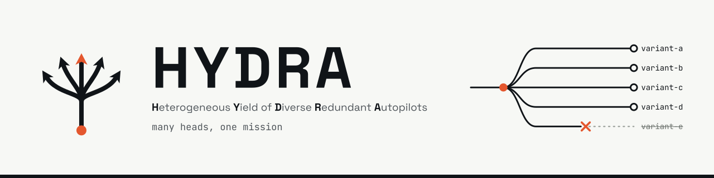

<picture>
  <source media="(prefers-color-scheme: dark)" srcset="docs/assets/hydra-banner-dark.svg">
  
</picture>

# HYDRA

HYDRA (Heterogeneous Yield of Diverse Redundant Autopilots, formerly DASA) is an Oregon State CS capstone research project. Autonomous vehicles often run identical software, so an attack found against one can transfer to every vehicle running the same code. HYDRA asks whether AI-generated software diversity can reduce attack transferability while preserving required mission behavior. It works with PX4 flight software in simulation: a mission plan is flown in PX4 SITL, and a verifier checks the `.ulg` flight log against the plan, reporting PASS, FAIL, or INCONCLUSIVE for each requirement.

Status: the three mission definitions and their tests are in place. The verifier is in progress.

## Quickstart

You need git and Python 3.12 or newer: `python3 --version` should print 3.12 or higher. On Windows, use WSL2 with Ubuntu and run every command inside it.

- macOS: if `python3` is older (Xcode's is 3.9), run `brew install python`. quick-setup needs Homebrew anyway.
- Ubuntu or WSL2: if creating the venv fails, run `sudo apt install python3-venv` and `rm -rf .venv`, then run the commands again.

Clone the repo (you need read access to `dasa-capstone/DASA`):

```sh
git clone https://github.com/dasa-capstone/DASA.git
cd DASA
```

Set up and run the full check:

```sh
python3 -m venv .venv
source .venv/bin/activate
pip install -r requirements-dev.txt
ruff check . && ruff format --check . && pytest     # the full check, same as CI
ruff format .                                      # fix formatting
```

Success looks like this: `ruff check .` prints `All checks passed!`, `ruff format --check .` reports every file already formatted, and `pytest` reports the mission tests as passed, with none failed.

## Flying the missions

The checks above don't need PX4. Flying the missions in `missions/` does. PX4 is installed with [`dasa-capstone/quick-setup`](https://github.com/dasa-capstone/quick-setup) (private; ask a team member for org access), which pins PX4 to v1.18.0-rc1, commit `fca3df865a`. Its README covers installing, launching, and flying. Why we use it, and which platforms are tested: [ADR 0001](docs/adr/0001-dev-environment.md).

## Repository layout

| Path | What's there |
|---|---|
| [`missions/`](missions/) | QGroundControl `.plan` files for the simple, medium, and survey missions |
| [`tests/`](tests/) | pytest tests; today they check the mission plans against their written definitions |
| [`docs/`](docs/) | Requirements, design, risks, decisions (`docs/adr/`), testing, and sources outside the repo |
| [`.github/`](.github/) | The CI workflow, the PR template, and Copilot review instructions |
| `pyproject.toml`, `requirements-dev.txt` | Tool settings and pinned dev dependencies |
| `verifier/` (planned) | The mission verifier |
| `diversification/`, `attacks/` (planned) | Variant generation (Blue) and failure and attack scenarios (Red) |
| `experiments/`, `scripts/`, `results/` (planned) | Listed in the project plan's repository structure |

## More

- [CONTRIBUTING.md](CONTRIBUTING.md): setup beyond this page, local checks, branches, review, and the Definition of Done.
- [AGENTS.md](AGENTS.md): rules for AI coding agents.
- [docs/](docs/): requirements, design, risks, decisions, testing, and where outside sources live.
