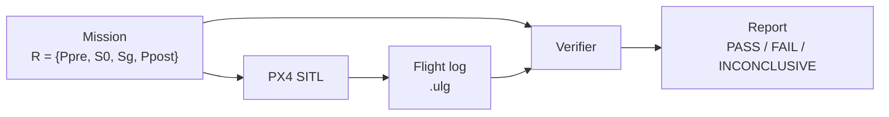
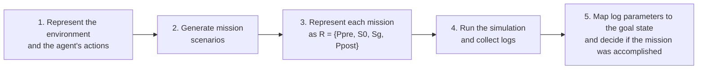
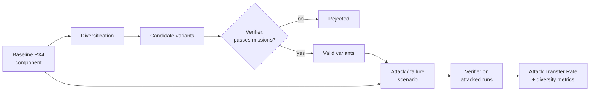

# Design
 
The system view someone needs to contribute safely. Reasons for decisions live in [`docs/adr/`](adr/); this file links them where they apply.
 
## Context
 
What the system is, and what it takes in and hands on.
Source: project doc §2, §4 and §5.
 
HYDRA tests whether AI-generated software variants of an autopilot still complete their missions and whether an attack that works on one variant transfers to the others. PX4 is the evaluation platform, run as software-in-the-loop (SITL) simulation in the development environment from [ADR 0001](adr/0001-dev-environment.md), which leaves the simulator and airframe open. The design must not depend on PX4 so the same approach can move to ArduPilot or other autonomous systems later.
 
The system has three parts:
 
| Part | Takes in | Hands on |
|------|----------|----------|
| **Mission verifier** (current focus) | A mission, represented as R = {precondition, start state, goal state, postcondition}, and the PX4 flight log (`.ulg`) of a run | A PASS / FAIL / INCONCLUSIVE verdict on whether the mission was accomplished, with a reason |
| **Blue workstream: diversification** | The baseline PX4 component chosen for Experiment 1 | Candidate variants. Only those the verifier passes count as valid. |
| **Red workstream: attacks and failures** | A baseline or variant build, plus a scenario (unusual inputs, parameter changes, command sequences, environmental perturbations, malformed data) | Whether the scenario caused a failure, judged by the verifier |
 
The shared experiment combines them. A scenario that breaks one implementation is run against the other valid variants:
 
**Attack Transfer Rate = other variants affected ÷ other variants tested**
 
All attacks and failures stay inside the simulation/test environment.
 
## Key diagrams
 
The pipeline (mission spec → PX4 SITL → `.ulg` flight log → verifier → report) and its parts.
Source: project doc §2.
 
### Baseline pipeline
 

 
### The five verification steps
 

 
### Full experiment (Fall target)
 

 
## Interfaces and contracts
 
The verifier's inputs (the mission and the `.ulg` log), its command, and its report format.
Source: verifier plan, "Starting suggestions"; [ADR 0003](adr/0003-independent-verifier-validation.md).
 
### Inputs
 
| Input | Contract |
|-------|----------|
| Mission | Represented as R = {precondition, start state, goal state, postcondition} (see [Data model](#data-model)). The file format is not decided yet. |
| Run | The PX4 flight log (`.ulg`) from the simulation. Which fields give evidence for each part of the state comes with the mapping write-up. |
| Mappings | Log parameters → parts of the goal state, each with a one-line reason. The format is pending; on Oct 28 the team proposed a declarative YAML spec. |
 
### Command
 
Not defined yet. It takes a mission and a flight log and writes a report.
 
### Report
 
- A PASS / FAIL / INCONCLUSIVE verdict on whether the mission was accomplished, with a reason. Missing or invalid evidence gives INCONCLUSIVE, never PASS (§6).
- The verifier runs on logs after the flight ([ADR 0002](adr/0002-verify-from-logs.md)) and doesn't stop at the first failure.
### Validation
 
The verifier is validated by teammates who did not build it ([ADR 0003](adr/0003-independent-verifier-validation.md)).
 
## Data model
 
The mission spec, the log topics and fields the checks use, and the result per requirement.
Source: project doc §6; verifier plan, "Starting suggestions" and "What our flights show".
 
### Mission representation
 
Since the Oct 30 meeting, each mission is represented as **R = {Ppre, S0, Sg, Ppost}**. This replaces §6's seven checks and the earlier draft definition. The details are still being settled.
 
| Part | Meaning |
|------|---------|
| Precondition (Ppre) | What must be true for the mission to be attempted. Specific to the mission. |
| Start state (S0) | A full snapshot of the environment (the agent and the objects in it) before the run |
| Goal state (Sg) | A full snapshot of the environment the mission must reach. One per mission. |
| Postcondition (Ppost) | What must hold once the mission is over. Specific to the mission. |
 
A run is the trajectory of states from the start state to the goal state: S0 → S1 → … → Sg.
 
### The five steps
 
1. Represent the environment for a given simulator (e.g. PX4) or domain (e.g. self-driving cars), and the actions the agent can take.
2. Create (generate) mission scenarios: simple, medium, complex.
3. Represent each mission as R = {Ppre, S0, Sg, Ppost}.
4. Run the simulation to collect execution logs.
5. Map log parameters to the goal state and decide whether the mission was accomplished.
### Example: photo mission
 
The drone flies from a to b, takes a picture at b, and returns to a.
 
- **Precondition:** the drone can take pictures.
- **Start state:** the drone is at a, and no picture has been taken at b.
- **Goal state:** the drone is back at a, and a picture has been taken at b.
- **Postcondition:** the drone was not attacked.
Start and goal states are full environment snapshots. The start state:
 
```xml
<env type="px4">
  <agent id="A">
    <x>0</x> <y>0</y> <z>0</z>
    <has_camera>true</has_camera>
    <was_attacked>false</was_attacked>
  </agent>
  <waypoint id="a">
    <x>1</x> <y>2</y> <z>3</z>
    <clicked_pic>false</clicked_pic>
  </waypoint>
  <waypoint id="b">
    <x>14</x> <y>22</y> <z>33</z>
    <clicked_pic>false</clicked_pic>
  </waypoint>
</env>
```
 
The goal state is the same snapshot except that waypoint b has `<clicked_pic>true</clicked_pic>`.
 
### Log evidence
 
The ULog topics and fields that give evidence for each part of the state come back once the mappings are written up with reasons (Oct 30 action item).
 
## Deployment
 
Where the walking skeleton runs in week 10, who owns the account or infrastructure, and who agreed it.
Source: handbook, Repo Checkpoint 1; project doc §11 (week 10).
 
**Draft, pending agreement with Manish:** The week 10 walking skeleton runs locally on team laptops, set up with [quick setup](https://github.com/dasa-capstone/quick-setup) in the development environment from [ADR 0001](adr/0001-dev-environment.md). Like the ADR, it leaves the simulator and airframe open. It demonstrates the pipeline end to end: missions are flown in simulation, the verifier judges each run from its log, and a first attack scenario is run against the baseline and a valid variant. No cloud or shared server is needed in Fall. **Owner:** The team (our own laptops). **Agreed by:** Confirm with Manish on Tue Nov 3.
 
## Deferred decisions
 
Decisions put off on purpose, with when each will be made.
Source: [`docs/testing.md`](testing.md#not-decided-yet), the one tracked list of open decisions; [ADR 0002](adr/0002-verify-from-logs.md) (live checking).
 
| Decision | Current choice | When it's revisited |
|----------|----------------|---------------------|
| Live, in-flight checking | Logs only ([ADR 0002](adr/0002-verify-from-logs.md)) | After the log verifier is stable, if early bail-out is needed |
| Mapping format | Mappings are being written up with reasons (Oct 30 action item); a declarative YAML spec was proposed Oct 28 | Once Manish confirms the approach |
| Mission file format | Not chosen; missions are represented as R | Once the representation is settled |
| Which PX4 component or behavior to diversify | Not chosen | Week 5 (Experiment 1 design) |
| First diversification approach and first attack/failure category | Not chosen | Weeks 4–5 (literature study) |
| Which diversity metrics to use | Candidates listed (token, AST, CFG, execution trace, trajectory) | Week 9 |
| Automated and random mission generation | Fixed missions first; generation is step 2 of the approach (Oct 30) | Once the representation is settled; random missions in Winter (§12) |
| ArduPilot as a second platform | PX4 only | Spring, if the PX4 study is stable |
 
## Open technical questions
 
Questions to answer with a spike or a test flight.
Source: [`docs/testing.md`](testing.md#not-decided-yet), the one tracked list of open decisions; verifier plan, "Two open questions" and "Open questions for Manish".
 
| # | Question | How to answer |
|---|----------|---------------|
| T1 | What tolerance values fit the current platform setup? | Repeated reference runs of the unmodified autopilot on the three missions |
| T2 | The ground-truth `*_valid` flags are never set in the logs recorded so far. How does the verifier detect missing or invalid position evidence instead (gaps, NaNs)? | Spike on existing logs, plus a deliberately truncated log |
| T3 | Which log fields give evidence for each part of the state, including properties PX4 doesn't log directly, such as "picture taken" or "was attacked" in Manish's example? | Mapping write-up, then a spike on existing logs |
| T4 | Do mappings need small transforms (units, frames, reducing a time series to a final value), or only direct field reads? | Spike: write the mappings for the simple mission |
| T5 | With QGroundControl out of the loop (Oct 29), how does a mission in R become something PX4 flies in simulation? | Spike on the simple mission |
| T6 | For the Attack Transfer Rate, how do INCONCLUSIVE runs count, and does a slower but successful run count as the attack succeeding? | Manish |
 